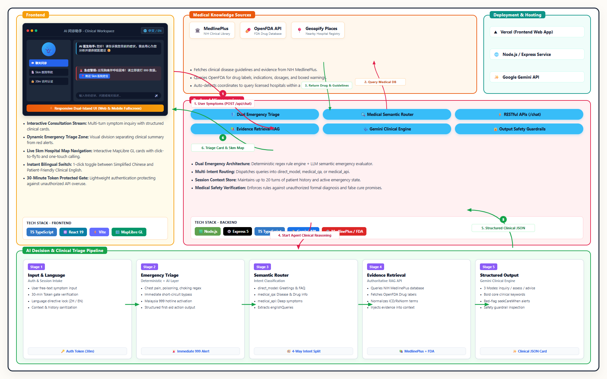

# 🩺 AI Doctor Assistant — Clinical Multi-Agent Consultation & Hospital Navigation System

[](https://opensource.org/licenses/MIT)
[](https://www.typescriptlang.org/)
[](https://react.dev/)
[](https://expressjs.com/)
[](https://ai.google.dev/)
[](https://maplibre.org/)

> **A production-grade, multi-stage clinical consultation and hospital triage platform powered by Google Gemini, authoritative medical knowledge bases (NIH MedlinePlus & OpenFDA), and Geoapify geospatial intelligence.**

---

## 📌 Table of Contents
- [Project Overview](#-project-overview)
- [System Architecture](#-system-architecture)
- [Multi-Agent Pipeline & Specialized Modules](#-multi-agent-pipeline--specialized-modules)
- [Key Capabilities & Differentiators](#-key-capabilities--differentiators)
- [Repository Structure](#-repository-structure)
- [Tech Stack](#-tech-stack)
- [Getting Started](#-getting-started)
  - [Prerequisites](#prerequisites)
  - [Backend Setup](#1-backend-setup)
  - [Frontend Setup](#2-frontend-setup)
- [Security & Access Control](#-security--access-control)
- [Medical & Safety Disclaimer](#-medical--safety-disclaimer)

---

## 📖 Project Overview

Navigating early-stage medical inquiries presents two major challenges: generic conversational LLMs often hallucinate ungrounded diagnoses or fail to detect life-threatening emergencies, while patients lack contextualized real-world care navigation.

**AI Doctor Assistant** bridges this critical gap through a decoupled, multi-stage clinical reasoning pipeline. Rather than treating inquiries as a single monolithic chat prompt, the system orchestrates:
1. **Deterministic & Semantic Emergency Triage**: Instantly identifying critical alerts (cardiac distress, drug overdose, anaphylaxis, seizures) with immediate emergency dispatch guidance.
2. **Intent-Driven Medical Data Routing**: Dynamically segregating conversational greetings, medical knowledge FAQs, and acute clinical symptom inquiries.
3. **Retrieval-Augmented Evidence Grounding**: Enriching reasoning contexts with peer-reviewed NIH MedlinePlus monographs and official OpenFDA drug package labels.
4. **Adaptive Clinical Layouts**: Dynamically adjusting responses into inquiry-first, assessment-first, or advice-first structures.
5. **Real-Time Geospatial Hospital Matching**: Guiding patients to licensed medical facilities within a 5km radius with live navigation and call actions.

---

## 🏗️ System Architecture

The following diagram illustrates the complete end-to-end data flow between the responsive client application, microservice backend, external clinical knowledge bases, and multi-stage triage pipelines:



---

## 🧩 Multi-Agent Pipeline & Specialized Modules

The platform delegates clinical consultation across modular, fault-tolerant processing agents:

### 1. Ingestion & Session Gatekeeper (`Input & Auth Gate`)
- **Token Verification**: Enforces a lightweight, 30-minute access token gate (`1234`) to protect computing quotas during private evaluation.
- **Language Lock**: Detects client-selected locale (`zh` / `en`) and enforces strict language directives across reasoning stages.
- **Session Context Memory**: Merges client history with server-side turn caches (up to 20 conversation turns) while preserving active emergency states.

### 2. Dual-Layer Emergency Triage Engine (`emergencyCheck.ts`)
- **Layer 1 (Deterministic Rule Engine)**: Pre-filters acute clinical triggers (crushing chest pain, respiratory distress, poisoning/overdose, seizures, stroke signs) using regex pattern matching.
- **Layer 2 (Semantic Risk Evaluation)**: Evaluates borderline context shifts to avoid hallucinations.
- **Short-Circuit Dispatch**: Bypasses general reasoning to trigger immediate rescue protocols (Malaysia 999 hotline & emergency department redirection).

### 3. Medical Semantic Router (`medicalDataRouter.ts`)
- Classifies patient intent into four optimized paths:
  - `emergency`: Critical condition handling.
  - `direct_model`: Non-clinical greetings, identity inquiries, and emotional reassurance without database overhead.
  - `medical_qa`: Objective disease and pharmaceutical encyclopedia questions, strictly preventing false illness attribution.
  - `medical_api`: In-depth symptom consultations requiring clinical grounding.
- Extracts standardized medical terminology (`englishQueries`) for database indexing.

### 4. Authoritative Evidence Retrieval RAG (`medicalDataService.ts`)
- **NIH MedlinePlus API**: Fetches evidence-based consumer health monographs, disease overviews, and symptom guidelines.
- **OpenFDA API**: Retrieves verified drug labels, active ingredients, clinical indications, adverse reactions, and black-box warnings.
- **ClinicalTables / RxNorm**: Normalizes informal terminology into standard clinical identifiers.

### 5. Clinical Synthesis & Layout Engine (`geminiHealthConsultation.ts`)
- Adapts output into three dynamic presentation layouts:
  - `inquiry_first`: Prioritizes targeted clarifying questions when symptoms are brief or ambiguous.
  - `assessment_first`: Delivers comprehensive etiology differential rankings and care plans once sufficient context is established.
  - `advice_first`: Elevates immediate actionable home-care guidance and dosing cautions when patients ask specific "what to do" questions.
- **Core Keyword Highlighting**: Extracts key medical terms, durations, and staging using Markdown bold (`**...**`).

### 6. Geospatial Hospital Navigator (`MapPanel.tsx` & `geoapifyPlaces.ts`)
- Integrates browser Geolocation with Geoapify Places API to retrieve registered hospitals within a 5km radius.
- Renders full-frame MapLibre GL vector maps synchronized with interactive hospital cards.
- Supports card-click `flyTo` camera panning, marker popups, one-touch phone dialing (`tel:`), and external GPS navigation.

### 7. Clinical Output Safety Guardrails (`outputSafetyCheck.ts`)
- Validates model responses before transmission.
- Blocks unauthorized formal diagnosis assertions (`"I officially diagnose you with..."`).
- Strips absolute cure guarantees (`"100% cure guaranteed"`).
- Prevents dangerous medical avoidance recommendations (`"Do not go to the hospital"`).

---

## ⚡ Key Capabilities & Differentiators

- **Dual-Island Aesthetic**: Modern 1:1 UI layout featuring a 3D doctor assistant character, clean conversation bubbles, and distinct emergency action zones.
- **Native Bilingual Synchronization**: Toggle between Simplified Chinese and Patient-Friendly Clinical English with zero language mixing.
- **Mobile-First Responsiveness**: Automatically transitions to a full-screen mobile view with a bottom-sheet feature navigation drawer.
- **Zero-Flicker State Preservation**: Switches between chat consultations and hospital maps instantly without unmounting or triggering re-renders.
- **Model Fallback Resilience**: Automatically cascades across candidate Gemini models (`gemini-3.5-flash-lite`, `gemini-3.6-flash`, etc.) when encountering rate limits (429) or transient provider outages.

---

## 📂 Repository Structure

```
AI-Doctor-Assistant/
├── AI_Doctor_Architecture_Diagram.png   # Full system architecture diagram
├── architecture_diagram.html           # Source HTML for diagram generation
├── consultation-backend/               # Node.js + Express 5 Backend
│   ├── src/
│   │   ├── app.ts                      # Express application & route definitions
│   │   ├── server.ts                   # Server entrypoint
│   │   ├── routing/
│   │   │   ├── medicalDataRouter.ts    # Intent classification & 4-way router
│   │   │   └── medicalDataTypes.ts     # Route and category data models
│   │   ├── safety/
│   │   │   ├── emergencyCheck.ts       # Dual-layer emergency triage engine
│   │   │   └── outputSafetyCheck.ts    # Clinical output guardrails & sanitizer
│   │   ├── schemas/
│   │   │   └── chat.ts                 # Validation schemas for chat requests
│   │   └── services/
│   │       ├── conversationStore.ts    # Multi-turn session memory
│   │       ├── geminiHealthConsultation.ts # Gemini clinical prompt engine
│   │       ├── geoapifyPlaces.ts       # Hospital spatial search service
│   │       └── medicalData/            # MedlinePlus, OpenFDA & RxNorm connectors
│   ├── package.json
│   └── tsconfig.json
├── consultation-frontend/              # React 19 + Vite Frontend
│   ├── src/
│   │   ├── App.tsx                     # Main application container & access gate
│   │   ├── App.css                     # Design system & responsive layouts
│   │   ├── ChatPanel.tsx               # Consultation stream & composer
│   │   ├── MapPanel.tsx                # MapLibre GL 5km hospital navigation
│   │   └── i18n.ts                     # Bilingual dictionary & translation keys
│   ├── public/                         # Static assets & 3D doctor hero sprites
│   ├── index.html
│   ├── vite.config.ts
│   └── package.json
└── README.md                           # Project documentation
```

---

## 💻 Tech Stack

| Domain | Technology | Purpose |
| :--- | :--- | :--- |
| **Frontend Framework** | React 19, TypeScript, Vite | Single Page Application with optimized bundle performance |
| **Geospatial & Maps** | MapLibre GL JS, Geoapify API | Open-source vector tile map rendering and local POI query |
| **Backend Framework** | Node.js (>=18), Express 5, TypeScript | High-throughput, type-safe RESTful API services |
| **Foundation Model** | Google Gemini API (`@google/genai`) | Clinical reasoning, multi-turn dialogue, and structured JSON generation |
| **Medical Evidence** | NIH MedlinePlus, OpenFDA, ClinicalTables | Peer-reviewed medical guidelines and official drug product labels |
| **Session & Security** | In-Memory Session Store, LocalStorage Token | Lightweight 30-minute access authentication & multi-turn history |

---

## 🚀 Getting Started

### Prerequisites
- [Node.js](https://nodejs.org/) v18.0.0 or higher
- [Google Gemini API Key](https://ai.google.dev/)
- [Geoapify API Key](https://www.geoapify.com/) (Free tier available)

### 1. Backend Setup
```bash
# Navigate to backend directory
cd consultation-backend

# Install dependencies
npm install

# Configure environment variables
cp .env.example .env
```
Fill in your credentials in `consultation-backend/.env`:
```env
PORT=8000
GEMINI_API_KEY=your_gemini_api_key_here
GEMINI_MODEL=gemini-3.5-flash-lite
GEOAPIFY_API_KEY=your_geoapify_api_key_here
FRONTEND_ORIGINS=http://localhost:5173,http://127.0.0.1:5173
```
Start the backend service:
```bash
npm run dev
# Server running at http://127.0.0.1:8000
```

### 2. Frontend Setup
```bash
# In a new terminal, navigate to frontend directory
cd consultation-frontend

# Install dependencies
npm install

# Configure environment variables
cp .env.example .env
```
Fill in your credentials in `consultation-frontend/.env`:
```env
VITE_API_BASE_URL=http://127.0.0.1:8000
VITE_GEOAPIFY_API_KEY=your_geoapify_api_key_here
```
Start the frontend development server:
```bash
npm run dev
# Application available at http://localhost:5173
```

---

## 🔒 Security & Access Control

To protect cloud API consumption during demonstration and peer reviews:
- **Passcode Gate**: Upon first visiting the site, users are prompted with a clean login card (Passcode: `1234`).
- **Time-Bound Token**: Successful verification generates a session token valid for **30 minutes**.
- **Seamless Refresh**: Page refreshes (`F5`) verify the active token validity from browser storage without interrupting ongoing sessions.

---

## ⚠️ Medical & Safety Disclaimer

**AI Doctor Assistant is an academic proof-of-concept and experimental portfolio project designed strictly for health education, informational reference, and preliminary care navigation.**

- It **does not** provide formal clinical diagnoses, prescribe prescription medications, or formulate binding medical care plans.
- It is **not** a replacement for direct in-person evaluation, diagnosis, or treatment by a licensed healthcare provider.
- If you or someone around you experiences life-threatening symptoms (such as acute chest pressure, severe breathing difficulty, sudden weakness or numbness, severe uncontrolled bleeding, or suspected poisoning), **immediately contact local emergency medical services (such as 999 in Malaysia or 911 in the US) or proceed to the nearest hospital Emergency Department.**

---

## 📄 License
This project is open-source under the [MIT License](LICENSE).
